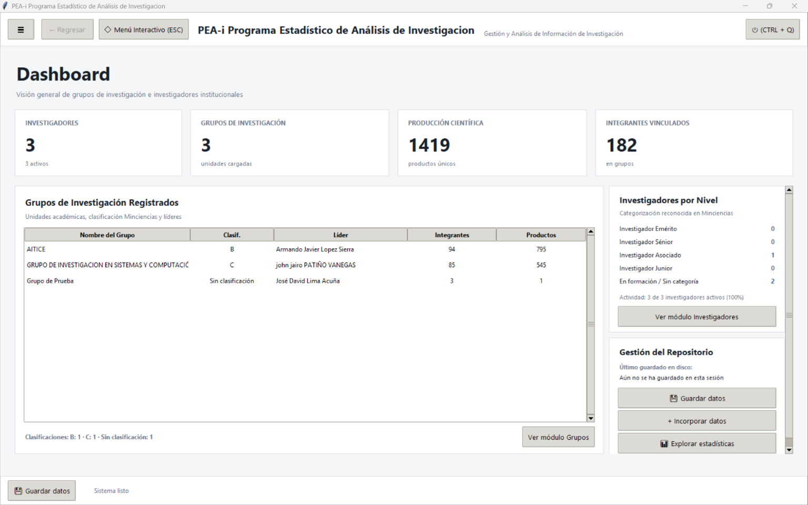
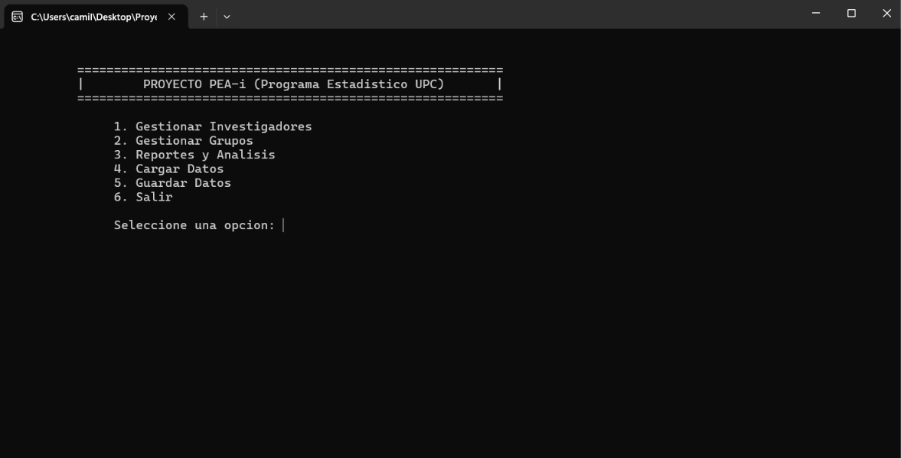

# PEA-i: Programa Estadístico de Análisis de Investigación

[](Proyecto_PEA-i/)
[](https://microsoft.com/windows)
[](https://isocpp.org/)
[](https://www.python.org/)
[](#licencia)

**PEA-i** es una plataforma integral de cienciometría y analítica de datos investigativos desarrollada para la **Universidad Popular del Cesar (UPC)**. Su objetivo es recolectar, estructurar, correlacionar y visualizar la producción académica de investigadores (perfiles **CvLAC**) y grupos de investigación (plataforma **GrupLAC**) reconocidos por el Ministerio de Ciencia, Tecnología e Innovación (**Minciencias**).

El sistema implementa una arquitectura desacoplada de alto rendimiento compuesta por:
- **Motor de Cómputo y Consola C++**: Núcleo eficiente en terminal para administración matricial, reportes y persistencia estructurada.
- **Frontend GUI y Motor de Extracción Python**: Interfaz gráfica moderna en Tkinter, extractor nativo web/PDF/CSV y microservicio API HTTP local (`127.0.0.1:8765`) que actúa como puente de interoperabilidad.

---

## Estructura del Proyecto

La distribución oficial se encuentra empaquetada dentro del directorio [`Proyecto_PEA-i/`](Proyecto_PEA-i/), estructurada de la siguiente manera:

```text
Proyecto_PEA-i/
├── PEA-i.exe                                              # Binario standalone ejecutable (GUI + Scraper API)
├── Proyecto_PEA-i_V1_1_1_(VERSION_ACTUAL).zip               # Paquete integral de distribución v1.1
│   ├── Aplicativo_CPP/
│   │   ├── DLDD-MAFF-JDLA.cpp                             # Código fuente C++ (Consola & Cliente WinHTTP)
│   │   ├── DLDD-MAFF-JDLA.exe                             # Ejecutable compilado C++
│   │   ├── PEA-i.exe                                      # Scraper local embebido
│   │   ├── grupos.txt                                     # Persistencia de grupos en texto plano
│   │   ├── investigadores.txt                             # Persistencia de investigadores en texto plano
│   │   └── scraper/
│   │       └── PEA-i.exe
│   ├── Aplicativo_Python/
│   │   ├── DLDD-MAFF-JDLA.py                              # Script unificado (GUI Tkinter + API REST + Extractores)
│   │   ├── grupos.json                                    # Persistencia relacional de grupos en JSON
│   │   └── investigadores.json                            # Persistencia relacional de investigadores en JSON
│   └── Archivos_de_Prueba/
│       ├── CSV/
│       │   ├── Prueba_CvLAC_Adith_Bismarck.csv
│       │   └── Prueba_GrupLAC_AITICE.csv
│       └── PDF/
│           ├── Adith Bismarck.pdf
│           └── Aitice.pdf
└── Versiones/                                             # Registro histórico de entregables
    ├── alphas                                             # Versiones Alpha del Aplicativo
    │   ├── Proyecto_PEA-i_Alpha_1.zip
    │   └── Proyecto_PEA-i_Alpha_2.zip
    ├── betas                                              # Versiones Beta del aplicativo
    │   └── Proyecto_PEA-i_Beta_1.zip ... Beta_7.zip
    └── releases                                           # Versiones Finales
        ├── Proyecto_PEA-i_V1_0.zip
        ├── Proyecto_PEA-i_V1_1.zip
        └── Proyecto_PEA-i_V1_1_1_(VERSION_FINAL_ACTUAL).zip
```

---

## Instalación y Requisitos

### Requisitos del Sistema
- **Sistema Operativo**: Windows 10 / Windows 11 (arquitectura de 64 bits).
- **Dependencias Externas**: Ninguna obligatoria para los ejecutables precompilados (`.exe`).

### Opción 1: Ejecución Directa (Recomendada para Usuarios Finales)
1. Descargue o ubique el paquete en [`Proyecto_PEA-i/`](Proyecto_PEA-i/).
2. Descomprima `Proyecto_PEA-i_V1_1_1_(VERSION_ACTUAL).zip`.
3. Ejecute directamente el aplicativo de su preferencia:
   - Para la interfaz gráfica: ejecute `PEA-i.exe`.
   - Para el entorno de terminal C++: abra la carpeta `Aplicativo_CPP` y ejecute `DLDD-MAFF-JDLA.exe`.

### Opción 2: Configuración del Entorno de Desarrollo

#### Entorno Python
Si desea ejecutar o modificar el código fuente en Python (`DLDD-MAFF-JDLA.py`):
```bash
# Crear y activar entorno virtual
python -m venv venv
.\venv\Scripts\activate

# Instalar dependencias requeridas para lectura de PDFs (PyMuPDF)
pip install PyMuPDF
```

#### Compilación en C++
Para compilar manualmente el motor de consola en C++ bajo Windows con MinGW/GCC:
```bash
cd Aplicativo_CPP
g++ -std=c++17 -O2 DLDD-MAFF-JDLA.cpp -o DLDD-MAFF-JDLA.exe -lwinhttp
```

---

## Guía de Uso

### 1. Interfaz Gráfica de Escritorio (GUI)

Al iniciar la aplicación, se presenta la ventana de **Configuración de Inicio**, permitiendo al usuario decidir si desea cargar los datos previamente almacenados en los archivos de persistencia (`investigadores.json` y `grupos.json`) o comenzar con una sesión limpia en memoria.

Inicie la aplicación en modo ventana ejecutando:
```bash
# Mediante el binario compilado
.\Proyecto_PEA-i\PEA-i.exe

# O ejecutando el script de Python directamente
python .\Proyecto_PEA-i\Aplicativo_Python\DLDD-MAFF-JDLA.py
```

**Módulos integrados en la GUI:**
- **Inicio**: Cuadro de mandos con métricas cuantitativas, investigadores activos y grupos vinculados.
- **Investigadores**: Catálogo, filtrado y vista detallada de producción por docente.
- **Grupos**: Clasificación de grupos de investigación y líneas declaradas.
- **Carga de Datos**:
  - Scraping directo ingresando URLs de CvLAC y GrupLAC.
  - Ingestión de archivos PDF de perfiles y reportes institucionales.
  - Importación masiva desde archivos tabulares CSV.
- **Estadísticas y Reportes**:
  - Generación de análisis comparativos cuantitativos y matrices de producción.
  - **Indicador de Producción Científica (Modelo MinCiencias)**: Módulo cienciométrico que calcula el índice de calidad y producción científica siguiendo los lineamientos oficiales de MinCiencias. La ventana organiza la información en dos pestañas dedicadas:
    - **Pestaña Investigadores**: Visualización tabular de investigadores con su ID, nombre, total de artículos requeridos, indicador obtenido y estado de evaluación.
    - **Pestaña Grupos de Investigación**: Visualización de grupos con su código, nombre, artículos requeridos, indicador y estado.
    - **Desglose de Producción**: Visor detallado que muestra la formulación matemática y la sustitución paso a paso, junto con la lista discriminada de artículos evaluados, su tipología (A1, A2, B, C, Open Access) y su peso relativo. Se puede abrir seleccionando un registro y pulsando el botón *Ver Desglose* o mediante **doble clic** sobre cualquier fila de las tablas.
- **Menú Interactivo (`ESC`)**: Visualizador interactivo 3D.

---

### 2. Modo Servidor API (Puente con C++)

Para permitir que el aplicativo C++ delegue tareas de extracción web en tiempo real, inicie el servicio API local en segundo plano:
```bash
.\Proyecto_PEA-i\PEA-i.exe --api
```
El servidor quedará a la escucha en `http://127.0.0.1:8765`, ofreciendo los siguientes endpoints:
- `GET /health`: Comprobación del estado del servicio.
- `POST /scraping`: Extracción remota enviando `tipoBusqueda` y `url`.
- `POST /cargar-archivo`: Procesamiento por lotes de archivos PDF y CSV mediante carga local.

---

### 3. Aplicativo de Consola C++

Al arrancar el aplicativo de terminal, se despliega el menú de **Configuración de Inicio de Datos**, donde el usuario elige si desea cargar los datos guardados en los archivos de texto plano (`investigadores.txt` y `grupos.txt`) o iniciar con la memoria limpia.

Inicie el motor de consola ejecutando:
```bash
.\Proyecto_PEA-i\Aplicativo_CPP\DLDD-MAFF-JDLA.exe
```

El menú principal en consola ofrece las siguientes opciones navegables:
```text
================ PEA-i PROGRAMA ESTADISTICO UPC ================

  [1] Gestionar Investigadores
  [2] Gestionar Grupos
  [3] Reportes y Analisis
  [4] Cargar Datos
  [5] Guardar Datos
  [6] Salir

Seleccione una opcion: 
```

**Funcionalidades cienciométricas en Reportes y Análisis (`[3]`):**
- Consulta general de indicadores de producción científica dividida en dos tablas formateadas (Investigadores y Grupos de Investigación).
- Consulta y desglose matemático paso a paso del indicador MinCiencias para un investigador o grupo específico mediante su ID o nombre.

Los datos procesados se almacenan y actualizan en los archivos de texto plano estructurado `investigadores.txt` y `grupos.txt`.

---

## Demostración

### Interfaz Gráfica de Usuario (Dashboard)
<!-- TODO: Reemplazar con captura de producción si se actualiza el tema visual -->


### Interfaz de Consola C++
<!-- TODO: Reemplazar con captura de producción si se agregan nuevos submenús -->


---

## Licencia

Este proyecto se distribuye bajo la **Licencia Académica Institucional de la Universidad Popular del Cesar (UPC)**.

- **Uso Autorizado**: Proyecto desarrollado con fines estrictamente académicos, científicos y de gestión investigativa formativa en la Universidad Popular del Cesar.
- **Restricciones**: Queda prohibida su comercialización total o parcial sin autorización previa y por escrito de la institución y de los autores del proyecto.

---

*Proyecto PEA-i — Universidad Popular del Cesar*
